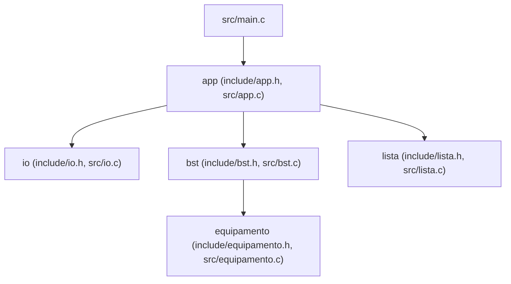

# Rede de Equipamentos e Conexões

Aplicação de terminal em **C11** para cadastrar equipamentos de rede (roteadores, switches, servidores...) em uma **Árvore Binária de Busca (BST)** e gerenciar IDs em uma **Lista Encadeada Simples**. É um projeto prático da disciplina de **Estrutura de Dados** (FATEC) e aplica, na prática:

- **TADs** (Tipos Abstratos de Dados) separados em `.h` / `.c`
- **Ponteiros** e gerenciamento manual de memória sem vazamentos
- **Árvore Binária de Busca (BST)** com inserção, busca, remoção (0, 1 e 2 filhos) e percurso em-ordem
- **Lista Encadeada Simples** própria com inserção no fim, remoção do início e exibição

Cada equipamento tem `id` (inteiro positivo e único), `nome`, `tipo` e `localização` (textos de até 79 caracteres úteis, armazenados em `char[80]`).

> 📓 O passo a passo completo do desenvolvimento, com ideias centrais, decisões técnicas e perguntas de revisão, está na pasta [`diario/`](diario/).

---

## Como executar

**Pré-requisitos:** `gcc` e `make` (opcional: `valgrind` para `make memcheck`). No Ubuntu/Debian, instale com `sudo apt install build-essential valgrind`.

```bash
git clone git@github.com:o-gariba/projeto-estrutura-dados-fatec.git
cd projeto-estrutura-dados-fatec
make run
```

### Menu interativo

```text
==========================================
SISTEMA DE ESTRUTURA DE DADOS
==========================================
1 - Cadastrar registro na BST
2 - Buscar registro por ID na BST
3 - Remover registro da BST
4 - Listar registros em-ordem
5 - Inserir ID na estrutura linear
6 - Remover da estrutura linear
7 - Exibir estrutura linear
0 - Encerrar
==========================================
Escolha uma opcao:
```

### Comandos disponíveis

| Comando | O que faz |
|---|---|
| `make` (ou `make all`) | Compila a aplicação, gerando o executável `bin/rede` |
| `make run` | Compila (se necessário) e executa `./bin/rede` |
| `make test` | Roda toda a suíte de testes (`test-unit` + `test-e2e`) |
| `make test-unit` | Compila e executa os testes unitários (`tests/unit/test_*.c`) |
| `make test-e2e` | Executa os testes ponta-a-ponta com entradas redirecionadas e `diff` |
| `make memcheck` | Executa Valgrind em todos os testes unitários e cenários E2E |
| `make sanitize` | Recompila com ASan + UBSan e executa `make test` |
| `make clean` | Apaga os arquivos gerados (`build/` e `bin/`) |
| `make help` | Lista todos os comandos disponíveis |

---

## Arquitetura e Complexidade



### Complexidade das operações

| Estrutura | Operação | Tempo médio | Pior caso | Espaço auxiliar |
|---|---|---|---|---|
| **BST** | Inserir (`bst_inserir`) | $O(\log n)$ | $O(n)$ | $O(h)$ |
| **BST** | Buscar (`bst_buscar`) | $O(\log n)$ | $O(n)$ | $O(1)$ |
| **BST** | Remover 0, 1 ou 2 filhos (`bst_remover`) | $O(\log n)$ | $O(n)$ | $O(h)$ |
| **BST** | Listar em-ordem (`bst_listar_em_ordem`) | $O(n)$ | $O(n)$ | $O(h)$ |
| **BST** | Destruir em pós-ordem (`bst_destruir`) | $O(n)$ | $O(n)$ | $O(h)$ |
| **Lista** | Inserir no fim (`lista_inserir_fim`) | $O(1)$ | $O(1)$ | $O(1)$ |
| **Lista** | Remover do início (`lista_remover_inicio`) | $O(1)$ | $O(1)$ | $O(1)$ |
| **Lista** | Exibir início→fim (`lista_exibir`) | $O(m)$ | $O(m)$ | $O(1)$ |
| **Lista** | Destruir (`lista_destruir`) | $O(m)$ | $O(m)$ | $O(1)$ |

*(Onde $n$ é a quantidade de equipamentos na BST, $h$ sua altura e $m$ a quantidade de IDs na lista encadeada.)*

---

## Entendendo os comandos

### Flags do compilador e ferramentas (`Makefile`)

| Trecho | Significado |
|---|---|
| `-std=c11` | Segue o padrão **C11** da linguagem, sem extensões específicas do compilador. |
| `-Wall -Wextra` | Liga avisos comuns e extras (variável não usada, comparação `signed`/`unsigned`, formato errado em `printf` etc.). |
| `-Wpedantic` | Avisa sobre qualquer construção fora do padrão ISO C. |
| `-Werror` | Transforma todo aviso em **erro**, impedindo que avisos passem despercebidos. |
| `-g` | Inclui símbolos de depuração (linhas e variáveis) para `gdb` e `valgrind`. |
| `-Iinclude` | Procura cabeçalhos `.h` na pasta `include/`. |
| `-fsanitize=address,undefined` | Instrumenta o binário com **ASan** (estouros de buffer, *use-after-free*, vazamentos) e **UBSan** (comportamento indefinido). |
| `valgrind --leak-check=full --show-leak-kinds=all --error-exitcode=1` | Detecta acessos inválidos e qualquer bloco de memória não liberado, falhando com código `1` se houver erro. |

### Como o Makefile funciona

1. **Compilação:** cada `src/X.c` vira um objeto `build/X.o` (regra `build/%.o: src/%.c`).
2. **Ligação (*linking*):** os objetos (exceto `main.o`) são reaproveitados tanto pelo executável final `bin/rede` quanto por cada binário de teste em `build/tests/`.

---

## Testes automatizados e reprodutibilidade (R08)

O projeto conta com:
- **Testes unitários** (`tests/unit/`): construídos com o mini framework próprio em [`tests/unit/test.h`](tests/unit/test.h), cobrindo `io`, `equipamento`, `bst` e `lista` (**23 testes em 5 suítes**).
- **Testes ponta-a-ponta (E2E)** (`tests/e2e/`): o script [`tests/e2e/run_e2e.sh`](tests/e2e/run_e2e.sh) alimenta `./bin/rede` com arquivos `.in` e compara a saída exata contra `.esperado` via `diff -u` (**4 cenários**).
- **Roteiro de evidências:** a tabela completa com entradas, passos, resultados esperados/obtidos e verificação de memória está em [`tests/ROTEIRO_EVIDENCIAS.md`](tests/ROTEIRO_EVIDENCIAS.md).

### Como reproduzir tudo

```bash
make clean && make && make test
make memcheck
make sanitize
```

Para executar manualmente um cenário E2E específico:
```bash
make
./bin/rede < tests/e2e/casos/01-bst-operacoes.in
```

---

## Estrutura do projeto

```text
.
├── include/
│   ├── app.h                  # Interface da aplicacao e menu
│   ├── bst.h                  # Interface da BST (R02, R09)
│   ├── equipamento.h          # TAD Equipamento e invariantes
│   ├── io.h                   # Leitura segura e validacao numerica/textual
│   └── lista.h                # Interface da Lista Encadeada Simples (R04, R09)
├── src/
│   ├── app.c
│   ├── bst.c
│   ├── equipamento.c
│   ├── io.c
│   ├── lista.c
│   └── main.c
├── tests/
│   ├── ROTEIRO_EVIDENCIAS.md  # Tabela reproduzivel de entradas, passos e resultados
│   ├── unit/                  # test.h + test_framework.c, test_io.c, test_equipamento.c, test_bst.c, test_lista.c
│   └── e2e/                   # run_e2e.sh + casos/*.in e casos/*.esperado
├── diario/                    # Diario tecnico detalhado de cada etapa (00 a 08)
└── Makefile
```

---

## Requisitos do projeto

| Código | Requisito | Status |
|---|---|---|
| R01 | Aplicação em C11 com `struct`, ponteiros, funções e menu interativo | ✅ |
| R02 | BST com inserção, busca por ID, remoção de nós com 0, 1 ou 2 filhos e listagem em ordem | ✅ |
| R03 | Na BST, rejeitar ID duplicado, zero, negativo, texto não numérico e valor fora do intervalo de `int` (e textos válidos até 79 chars) | ✅ |
| R04 | Implementar estrutura linear dinâmica própria (Lista Encadeada Simples) com inserção, remoção e exibição | ✅ |
| R05 | Lista guarda IDs inteiros positivos independentes da BST (permite inexistentes na BST, repetidos e persistência após exclusão) | ✅ |
| R06 | Lista: inserir no fim, remover do início e exibir do início ao fim | ✅ |
| R07 | Ao remover de lista vazia, informar o usuário e manter funcionando; liberar toda memória ao encerrar | ✅ |
| R08 | Testes reproduzíveis com entradas, passos e resultados esperados/obtidos e guia de reprodução no README | ✅ |
| R09 | Separar obrigatoriamente BST em `bst.h`/`bst.c` e modularizar a lista encadeada em `.h`/`.c` | ✅ |
| R10 | Repositório Git individual, README e relatório técnico em PDF | 🟨 código/README/base prontos; gerar PDF final a partir de `diario/08-consolidacao-relatorio.md` |
